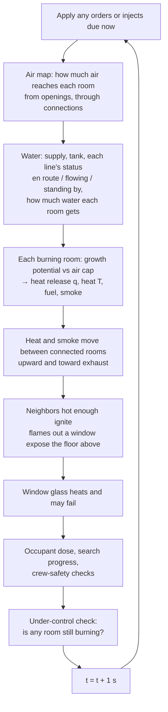

# How SizeUp's simulated fire works

*For fire officers. This describes the code in `src/model.js` exactly as it runs today (SizeUp v2, updated Oct 9, 2026: companies and dispatch, editable task times, per-engine water, time of day and weather, wind-driven fire; earlier the same day: knockdown, multiple lines, attic access, under-control state).*

> **Read this first.** SizeUp uses a **teaching model**, not fire physics. It is not CFAST, FDS or any validated zone/CFD model. Every number in it is a **dimensionless index** (0 = nothing, 1 = "flashover-level"), not °F, kW or ppm. The model's job is to put events in the **right order with roughly the right timing**, and to react to tactics the way the UL FSRI experiments describe. It cannot predict any real building. Training prototype, not for operational use.

Each rule below is labelled:
- **[FSRI: source]**: the behavior or timing is set to match a finding on the named UL FSRI page (quotes are in the app's *Behind the behavior* panel).
- **[Teaching value]**: a number chosen so the drill plays sensibly. It is not from research.

FSRI sources referred to:
- **VVR**: *Fire Service Summary Report: Vertical Ventilation and Suppression Tactics in Single Family Homes* (PDF)
- **VV**: *Effectiveness of Fire Service Vertical Ventilation and Suppression Tactics*
- **HV**: *Impact of Ventilation on Fire Behavior in Legacy and Contemporary Residential Construction*
- **CFA**: *Study of Coordinated Fire Attack Utilizing Acquired Structures*
- **FA**: *Impact of Fire Attack Utilizing Interior and Exterior Streams*
- **PPV**: *Effectiveness of Fire Service Positive Pressure Ventilation*
- **CBYD**: *Close Before You Doze: Before & After*

Other research referred to (wind-driven fire only):
- **NIST-WD**: NIST TN 1618, *Fire Fighting Tactics under Wind Driven Conditions: Laboratory Experiments* (Madrzykowski & Kerber, 2009), and NIST TN 1629, *… 7-Story Building Experiments* (2009). Read: the NIST publication pages and abstracts.

---

## 1. The building as the model sees it

- **Rooms ("zones")**: living room, kitchen, foyer, bedrooms, hall, attic/cockloft, and so on. Each has a size factor `vf` (1 = typical room; a big open room is 1.2–1.4). Bigger rooms heat and fill with smoke more slowly.
- **Openings to the outside**: windows, doors, the garage door, roof vents you cut. Each opening is *closed*, *open*, *failed* (broken glass) or *controlled* (door held to hose width).
- **Connections between rooms**, each with a "how freely do heat, smoke and air pass" number `k`:

| Connection | k | Label |
|---|---|---|
| Open archway / open plan | 1.0 | Teaching value |
| Interior door open | 0.9 | Teaching value |
| Open stair | 0.85 | Teaching value |
| Ceiling pushed (after roof/ceiling breach) | 0.6 | Teaching value |
| Interior door **closed** | 0.025 | Teaching value; the effect is FSRI: VVR/CBYD (closed door protects the room) |
| Intact ceiling to attic | 0.02 | Teaching value |
| Wall | 0.004 | Teaching value |

## 2. What each room tracks

| State | Meaning | Range |
|---|---|---|
| `q` heat release | How hard the fire in this room is burning | 0 → ~1.4 (a flashed room is driven toward 2) |
| `T` heat | Hot-gas temperature index; **1.0 = flashover level** | 0 → ~1.5 |
| `s` smoke | How full of smoke the room is | 0 → 1 |
| `R` oxygen reserve | Air still trapped in the room/building that the fire can use | 1 at ignition → 0 |
| `fuel` | Fuel remaining | 1 → 0 |
| `wet` | How much water has cooled the room and its fuel | 0 → 1 |
| `steam` | Steam from water application (whitens smoke) | 0 → 1 |
| `kd` knockdown hold | Seconds the room has stayed wet, low and cool (see 5) | 0 → 10 s |
| `smold` dry time | Seconds a knocked-down room has sat dry with no water and no line standing by | 0 → 600 s |
| flags | ignited, ventilation-limited, decaying, flashed over, **suppressed** (water has taken away the post-flashover boost), knocked out, burned out, rekindled once | yes/no |

The building also tracks **under control** (the time every room that ignited was knocked down or burned out) and each hoseline (id, target, ready time, status).

Each opening also tracks a **glass heat** counter, and the hidden occupant (if any) tracks an exposure **dose** (0 → 1).

## 3. The clock: one-second steps

- The model advances in **1-second steps**. Before arrival it runs silently for the "time since ignition" you chose (e.g. 210 s). At arrival the drill clock reads T+0:00.
- At 1× the app runs one step per real second; 2×, 4× and 10× run 2, 4 or 10 steps per second. Evolve and +1 min run many steps at once.
- Every order or inject is a timestamped action. The same scenario, seed and actions always replay to exactly the same result.

Each step runs in this order:



## 4. Step by step

### 4a. Air supply (the flow path's "in" side)

Each opening lets in air according to its state:

| Opening state | Air value | Label |
|---|---|---|
| Closed window (leakage) | 0.004 | Teaching value |
| Closed door (leakage) | 0.007 | Teaching value |
| Door **controlled** (to hose width) | 0.15 | Value is teaching; the effect is FSRI: VVR, CFA ("the door should be controlled until water is applied") |
| Open/failed window | 0.5 | Teaching value |
| Open door | 1.0 | Teaching value |
| Open garage door | 1.5 | Teaching value |
| Roof vent | 1.25 | Teaching value |

- **Wind** blowing into an opening multiplies its air by 1.4 / 1.9 / 2.6 for light / moderate / strong. [Simplification]
- A **PPV fan** adds +1.6 air to the room at the entry door. [Teaching value]

Air then spreads through the house in four passes:

```
air[room] = own openings + Σ over connections ( k × air[neighbor] × 0.6 )
```

Air reaching a room through an open stair or hall counts, but almost none passes a closed door (k = 0.025). That is how a **remote vent opening a flow path to the fire** shows up. [FSRI: HV, VVR, flow path]

If there is a **high exhaust** (a roof vent) in the room or a connected one, the room's air is boosted by up to 90% (`× (1 + min(0.9, 0.7 × exhaust))`), modeling low intake / high exhaust. [Behavior FSRI: VV; size teaching value]

### 4b. How a fire grows: the growth curve

A burning room has a **growth potential** that follows a "t-squared" curve, a standard fire-engineering shape:

```
potential = min(1.25, (time since ignition ÷ tg)²)
```

| Contents | tg (growth time) | Response time τ (heat release) | τT (heat) | Smoke factor | Fuel load |
|---|---|---|---|---|---|
| Modern synthetic | 250 s | 22 s | 50 s | 1.35 | 1000 |
| Legacy | 1400 s | 100 s | 190 s | 0.85 | 2600 |

These values were **tuned to FSRI: VVR timing**. FSRI found that a closed house went ventilation-limited in **about 5 minutes with modern fuel vs about 18 minutes with legacy**, and that ventilation-to-flashover took **about 2 minutes (modern) vs over 8 minutes (legacy)**. What SizeUp produces (living-room fire, closed house, glass held):

| | FSRI (VVR) | SizeUp today |
|---|---|---|
| Modern: ignition → ventilation-limited | ~5 min | 4.0 min (240 s) |
| Legacy: ignition → ventilation-limited | ~18 min | 16.7 min (1002 s) |
| Modern: door opened at 8 min → flashover | ~2 min | 1.8 min (107 s) |
| Legacy: door opened at 18 min → flashover | >8 min | ~16 min (982 s) |

The shape matches; the exact minutes are approximate.

Other rules:
- After flashover the potential is set to 2, meaning "burn as hard as the air allows." Once water has cooled a flashed room (water on it and wet > 0.5) it is marked **suppressed** and the boost is removed: the potential goes back to the normal curve. If it dries out (wet < 0.1) and regrows past q 0.6, the boost returns and the log says the fire regrew. [Simplification]
- An attic grows 1.6× slower.
- Below 25% fuel remaining, the potential falls with the fuel.
- Water multiplies the potential by (1 − 0.97 × wet).

### 4c. The air cap: ventilation-limited fire

The fire can only burn as hard as its air allows:

```
air limit      = 0.03 + 0.62 × air reaching the room
oxygen reserve R: refills slowly through openings, drains when the fire burns above the air limit
   R ← R + [ (own openings + 0.02) × 0.012 × (1 − R)  −  (q − air limit) × 0.0105 ÷ room size ] each second
cap            = air limit + 1.3 × R
target         = smaller of (potential, cap)
q              moves toward target:  q ← q + (target − q) ÷ τ   each second
```

- At ignition `R = 1`, so a closed room grows on its trapped air at first. As the fire uses that up, `R` falls and the cap drops toward the leakage-only air limit.
- **Ventilation-limited** is flagged when the potential exceeds the cap by more than 0.03 (and the room isn't wet).
- **Decay (starved for air)** is flagged when it is ventilation-limited, the reserve is below 0.15, and the air limit is below 0.35.

This reproduces the FSRI sequence: growth, then ventilation-limited, then decay while the house stays hot. **New air from any source (a failed window, an opened door, a vent) raises the cap and starts a second growth stage.** [FSRI: VVR, "Once an opening is made, a second growth stage begins"]

**Lag**: `q` rises with τ = 22 s (modern) or 100 s (legacy), halved after flashover. Heat `T` lags further behind (τT 50 / 190 s). That is why a vent can look good for a minute and then turn bad. [FSRI: VVR, "The fire does not react to additional oxygen instantaneously… 2 minutes later…"]. The values themselves are tuned teaching values.

### 4d. Heat, fuel and smoke inside the room

```
heat target  = min(q, 1.3) × 1.15 (attic 1.0) ÷ √(room size) × (1 − 0.6 × wet)
T            moves toward heat target with τT rising; falls with a 240 s lag (6 s while water is on it)
fuel         ← fuel − q ÷ fuel load   each second
smoke made   = q × 0.02 × smoke factor ÷ room size  (+ steam × 0.004)
smoke vented = smoke × own openings × (0.012 + 0.03 × min(1.5, T))   (× 1.8 with a fan running)
```

All of these constants are teaching values.

### 4e. Flashover

A room flashes over when **heat T reaches 1.0 and heat release q is at least 0.75** (attics don't "flash"; they ignite). After that the room burns at whatever the air allows, and flames show at its openings. The trigger level is a teaching threshold. The *timing* it produces is calibrated to FSRI: VVR (section 4b).

### 4f. Heat and smoke moving between rooms; spread

For each connection, every second:

```
smoke moved = (smoke difference) × k × 0.035   capped at 0.05
heat moved  = (heat difference)  × k × 0.018   capped at 0.03
```

- Movement **upward** is ×1.5 and **downward** ×0.45, because hot gas rises.
- Movement toward a room that has exhaust openings is multiplied by (1 + exhaust) for smoke and (1 + 1.6 × exhaust) for heat. Heat and smoke head for the vent, which is the flow-path effect. [FSRI: HV, VVR]
- A running fan multiplies heat movement ×1.6. [Teaching value; behavior FSRI: PPV]
- The receiving room gains 90% of the moved heat (÷ its size); the sending room loses 25%. The gap stands in for hot gas still flowing.

**Spread / extension**: an unburned room ignites when its heat passes **0.82** (the attic at **0.60**) and it isn't wet. It starts partway up its own growth curve (a head start of 0.55 × tg). [Teaching values]

**Exterior extension**: once a flashed room has had flames showing out an opening for **200 s**, the room above is exposed (its heat is set to at least 0.9), or the attic if it is the top floor. On non-wood construction the window above also fails. [Simplification]

**Roof vent / attic**: a vertical vent opens a 1.25 roof opening and **pushes the ceiling below it** (the connection goes from 0.02 to 0.6). This ties the attic into the fire. [FSRI: VVR / VV]

### 4g. Window glass failure

Each closed window keeps a heat counter:

```
glass heat += [ (T − 0.30 if positive) + 1.5 × (T − 0.60 if positive) ]  each second
fails when glass heat > threshold, threshold = 14 to 31.5 (set randomly per window by the scenario seed)
```

With modern contents and the default 3½-minute arrival, the living-room glass fails about **4:50–5:20 after ignition**, and flashover follows about **80–85 s** later. The choice **"Window glass: Holds"** only lets glass fail above heat 0.72. That keeps the closed-house decay FSRI describes.

**This whole rule is a simplification.** FSRI notes the fire *can* fail a window, but the timing here is a teaching value, not an FSRI measurement.

### 4h. What you see: smoke volume, velocity, density, color

These come from the room the smoke is leaving. **The cue mapping is the widely taught "Reading Smoke" approach, not an FSRI measurement. [Simplification]**

| Cue | Driven by | Steps |
|---|---|---|
| **Velocity** (pressure) | `P = T × (0.6 + 0.6 × smoke) × 1.25 if ventilation-limited` | <0.18 Lazy · <0.45 Moderate · <0.8 Pressurized · else Turbulent. A decaying fire is capped at Moderate and shown **pulsing** [FSRI: VVR] |
| **Volume** | `q × smoke factor + 0.6 × smoke` | <0.25 Light · <0.6 Moderate · <1.05 Heavy · else Very heavy |
| **Density** | room smoke `s` | <0.3 Thin · <0.55 Moderate · <0.8 Thick · else Very thick. Ventilation-limited with s > 0.6 → at least Thick; flashed and ventilation-limited → Very thick |
| **Color** | state | Steam > 0.25 → **white**. Cool early fire → white/gray. Attic, or wood structure burning 7+ min after flashover → **brown**. Ventilation-limited or hot (T > 0.7) → **black** (modern) / gray-black (legacy). Otherwise **gray** |

**How much smoke leaves each opening:**
- Open: `smoke × (0.4 + T)`, ×0.35 if the door is controlled, ×1.6 for a roof vent, and ×1.7 at the other openings when a fan is running.
- Closed (leaking around the frame): `(smoke − 0.3) × (0.3 × T + 0.25 × building pressure)`. The volume and velocity you can see from a gap are capped (Moderate, or Heavy if it's pushing hard).
- **Building pressure** = `1.7 × q × T` of the hottest fire ÷ (1 + 2.5 × total open-opening area), capped at 1. A growing fire in a closed-up house pushes smoke around windows, doors and at the eaves; opening the house relieves it. [Simplification]

**Neutral plane**: an open window exhausts from its top ~65%, a door from its top ~50%. Below that, air flows in. This affects how it is drawn. [Behavior FSRI: VV/VVR; fractions are teaching values]

**Flow path shown on the board**:
- An open opening with smoke outflow above 0.05 is an **exhaust**. A door or garage is listed as exhaust at the top *and* intake at the bottom.
- Open openings with little outflow are **intakes**.
- A roof vent is always exhaust; a fan door is always intake.

**Fire showing**: flames show at an opening of a flashed room when `q > 0.7` (size `0.6 × q`), or at a window of an unflashed room when `q > 0.6`. Water cuts visible flame to 25%.

**Stage label** (fire room): Incipient (q < 0.12) → Growth → Growth (ventilation-limited) → Decay (starved for air) → Fully developed → Decay (fuel consumed / water applied) → Knocked down (or Burned out).
- A room that water has darkened (wet > 0.3, q < 0.25) but that is not yet knocked down reads **Decay (darkened by water, can regrow)**, not "Fully developed".
- A flashed room burning below q 0.5 reads **Decay (after flashover)**.

**After knockdown** (simplification): a knocked-down room makes no new smoke, and what is left clears about 3× faster (plus a small extra clearing term). Its smoke is drawn **white/light** like cooling smoke and steam, with velocity capped at Moderate. Once the fire is under control, rooms that only had smoke clear the same way. Flames and window glow stop at knockdown.

## 5. What your orders do to the numbers

### 5a. Companies, crews and who does what [Simplification]

Before the drill, the **Dispatch** tab builds the assignment. The default preset, **Generic first alarm (residential)**, is a set of generic, editable teaching defaults. It is **not any department's SOP**.

| Unit | Staff | Arrives after dispatch | Equipment (editable) |
|---|---|---|---|
| Engine 1 | 4 | 4:00 | 1000 gal tank, 1500 gpm pump, 1000 ft supply hose, ground ladder, hooks; preconnects 1¾ in. 200 ft 150 gpm ×2 and 2½ in. 200 ft 250 gpm |
| Medic 1 | 2 | 5:30 | rehab / EMS standby |
| Engine 2 | 3 | 6:00 | same as Engine 1 |
| Battalion 1 | 1 | 6:30 | command only |
| Ladder 1 | 4 | 7:00 | ground ladders, aerial, PPV fan, saws, hooks |
| Engine 3 | 3 | 8:00 | same as Engine 1 |
| Rescue 1 | 3 | 9:00 | ground ladders, PPV fan, saws, hooks |

- **T+0 on the drill clock is when the first company arrives.** Later companies arrive at their dispatch time minus the first company's, and are **staged** until assigned. The board shows each company as *en route* (with a countdown), *staged*, *working* (task and countdown) or *available*.
- **Crew rules.** Each task needs a minimum crew: hoseline 2 (a 2½ in. line 3), primary or secondary search 2, horizontal vent 1, vertical vent 2, PPV 1, door control 1, pull ceiling 2, ladder a side 2, RIT 2 or more, scene lighting 1, rehab 1. An **engine always keeps 1 member at the pump**. A company works one task at a time, and **splits** to take a second task only if it has enough unassigned members left over. (Example: Engine 1 with 4 has 1 at the pump and 2 on a line, so 1 member is left for door control.)
- **Equipment rules.** Vertical vent needs saws and a ladder or aerial. PPV needs a fan. Pull ceiling needs hooks. An upper-floor window can only be vented by a company with ground ladders (or an aerial), or after that side has been laddered. A medic only does rehab; the chief only commands.
- **Assigning.** You can assign a task to a specific company on the board, or use **quick orders**, which pick the company that can start soonest (ties go to the usual type for the task, e.g. a truck for ventilation). A task given to a company that is still en route starts when it arrives. A busy company is refused with the reason: what it is doing, how many members are free, and how many the task needs. **Reassign** releases the company's current tasks and starts the new one. **Release** and **Withdraw** free the crew at once.
- **Lines are limited by crews and preconnects**, not by a fixed cap. A line uses a specific preconnect on a specific engine (its own, or any engine on scene for a truck or rescue crew).

### 5b. Task times [Teaching values, editable per drill]

Every number below is on the **Task times** tab, saved and exported with the drill. Each time is then multiplied by the **company factor**:

```
company factor = (1 + 0.15 × members below 4)      short staffing
               × 1.2 if cold & icy
               × (1 + 0.10 per 10 min the company has been working, up to +0.30)   if hot; rehab halves the build-up
```

| Task | Time (before the company factor) | Effect |
|---|---|---|
| Interior line | crew **enters** at 35 s + 0.08 s × hose needed (ft); **ready** after another 30 s per floor above the 1st + 15 s | Entering **opens the entry door** (or *controls* it if door control is on). Water starts at the ready time if there is fire within reach |
| Line to the attic/cockloft (via a room) | interior line time to the room below + 30 s to pull the ceiling | The ceiling between that room and the attic is **breached** (k 0.6). Water: **0.8** into the attic, **0.6** into the room below [Simplification; the ceiling-opening behavior follows FSRI: VV] |
| Exterior line | 35 s + 0.08 s × hose needed + 15 s | Breaks/opens that opening; water only into that room. Openings on any side can be used |
| Exterior line through a roof vent | exterior line time + 30 s per story | Only after a vertical vent is open. Water goes into the attic/cockloft |
| Reassign a line | interior → interior: 30 s + 30 s per floor moved (+30 s if pulling a ceiling); exterior → exterior: 30 s; inside ↔ outside: a new stretch | The line must still be long enough for the new target |
| Withdraw a line / release a task | immediate | The crew is free again |
| Supply line (forward or reverse lay) | 45 s + 0.15 s × hydrant distance (ft) + 45 s hookup (+30 s for a reverse lay) | The receiving engine's lines stop drawing on its tank. Default hydrant 400 ft → 150 s, ×1.15 for a 3-member engine |
| Horizontal vent | 15 s | Opening becomes open/failed |
| Vertical vent | 300 s (×0.8 with an aerial) | Roof hole + ceiling pushed below it |
| PPV/PPA fan | entry door opens when the crew starts; fan on after 60 s | See below |
| Primary search | 60 s + 30 s per floor above the 1st + 120 s | Opens the entry door when the crew starts; secondary search ×1.3 |
| Pull ceiling (a room) | 30 s | Opens that room's ceiling to the attic, so a line in that room can reach it |
| Ladder a side | 45 s (×0.9 with an aerial) | Upper-floor windows on that side can then be vented by any company |
| Door control | immediate (1 member stays at the door) | Entry door held to hose width |
| RIT | 60 s to be in place | Logged; listed in the debrief |
| Scene lighting | 90 s | At dusk or night, smoke colour becomes readable (see 5d) |
| Rehab (medic) | 60 s | Heat fatigue builds at half rate while it is set up |

**Hose reach** [Teaching values]: a line must be at least as long as the hose needed:

```
interior:  setback (50 ft) + 25 ft to the room + 20 ft per floor above the 1st (+20 ft for a rear/hidden room, +10 ft for an attic line)
exterior:  setback + 15 ft (+40 ft to Side B or D, +80 ft to Side C) + 20 ft per floor above the 1st
```
If no free preconnect is long enough the order is refused: "Hose too short: … needs about N ft". A supply lay needs at least the hydrant distance of supply hose on the laying engine.

### 5c. Water: per-engine tanks, supply and gpm [Simplification]

- Each engine's **tank feeds only its own lines** until a supply line connects to that engine. A flowing line draws its own **gpm** (150 gpm = 2.5 gal per second). With the default 1000 gal tank, one 1¾ in. line runs about 6.7 min and a 2½ in. line about 4 min.
- **Low-tank warning** at 25% of that engine's tank; when it is empty, that engine's lines stop and restart once its supply is connected. Other engines are not affected.
- The **pump rating** caps an engine's total flow; above it, every line on that engine flows proportionally less (logged).
- **Water on the room scales with gpm**: a line's water = gpm ÷ 150 (limited to 0.4–1.7), so a 2½ in. line at 250 gpm wets a room about 1.7× faster than a 1¾ in. at 150 gpm. The knockdown thresholds are unchanged, so the FSRI-calibrated fire growth is untouched.

**Water** (rooms that receive it):
- An interior line gives its room **1.0**, and **0.45** to rooms joined by an open plan, open stair or open door.
- An exterior stream gives **0.85** to that room only.
- Each second under water:
  - wet rises by water ÷ 25
  - heat drops by 3.5% × water
  - heat release drops 6% × water and its target collapses with a 4 s lag
  - steam builds, so the smoke turns white
- **Knockdown** happens when the room has stayed **wet > 0.8, q < 0.12 and heat T < 0.3 for 10 s in a row** (the older rule, wet > 0.85 and q < 0.03, still counts too). Because water removes the post-flashover boost (4b), **flashed-over rooms can be knocked down**. Typical result: a flashed living room goes out about 35 s after the line starts flowing. [Simplification; the knockdown thresholds are teaching values]
- **Burned out**: a room with under 5% fuel left and q < 0.05 (and not air-starved) is marked burned out.
- **Lines stand by when there is no fire within reach.** Each line has a reach: its room plus the spill-over rooms above, or the attic and the room below for a pulled ceiling, or the one room for an exterior stream. If nothing in its reach is burning for 20 s, the line shuts down, but the crew stays in position. If fire comes back within its reach, the line starts flowing again. A line sent to a room with no fire stands by from the start, so it does not drain the tank.
- **Overhaul and rekindle** [Simplification]:
  - A knocked-down room with more than 30% fuel left can **rekindle once**. That needs it to sit **dry (wet < 0.05) for 600 s** with no water on it and **no interior line in position covering it**.
  - For an upper-floor room knocked down only from outside, the wait is 120 s (see the next point).
  - A rekindle restarts the growth curve from zero, so it is slow to build. It un-sets "under control" and is logged.
- Wet dries off slowly (over 900 s). For an **upper-floor room hit only from outside**, it dries in **70 s**, so the room can **regrow** unless an interior line follows. [FSRI: CFA]
- Water from any direction cools the fire room and the rooms around it. [FSRI: VVR, the 40% / 22% finding; this behavior is qualitative and the code is not tuned to those exact percentages]
- Water does not push fire; only flow paths move it. [FSRI: VVR]

**Ventilation**:
- Horizontal and vertical vents simply add openings, raising air (the cap) and exhaust. If water isn't yet winning, the fire grows. [FSRI: VVR, VV]
- **Door control** changes the entry door's air from 1.0 to 0.15 and its outflow ×0.35. [FSRI: VVR, CFA]
- **PPV**:
  - adds +1.6 air into the entry room
  - multiplies heat movement ×1.6 and smoke venting ×1.8
  - multiplies outflow ×1.7 at every other opening, so a fan helps only when there is an exhaust in the fire room [FSRI: PPV, "Positive Pressure Attack is exhaust dependent"]
- **Defensive strategy** withdraws interior lines (the log names them) and stops searches. In Defensive the line list defaults to exterior streams.

**Multiple lines** [Simplification]:
- Any number of hoselines can work at once, interior and exterior in any mix, **as long as there are crews and preconnects** (5a). Each is listed on the board with its company, target and status: en route (with countdown), flowing, standing by, or no water (that engine's tank is empty).
- A new order **adds** a line; it never silently replaces one. When no company can staff it, the order is refused with the reason.
- Where two lines reach the same room, it gets the larger of their two amounts of water (amounts are not added together).

**Under control**:
- When every room that ignited is knocked down or burned out, the model logs **"Fire under control"**.
- The app then pauses the clock, shows a banner with *Open debrief* / *Keep playing*, and clears the flashover chip.
- If a room rekindles later, the state is cleared and logged.

**Picking orders while the clock runs**: the order dropdowns keep your choice when the board refreshes. The line list puts **burning rooms first** (🔥) and preselects the first burning room that has no line yet. One-tap chips (＋ Line → room) appear for burning rooms. Pressing an order button with nothing picked shows a message.

### 5d. Time of day and weather [Simplification unless marked]

- **Time of day** (day / dusk / night) changes what you see, not the fire. At dusk and night the photo is darkened and tinted, **fire glow lights the windows, the smoke and the nearby facade**, and smoke is drawn with low contrast so its colour is **hard to read**; the board says so. A company assigned to **scene lighting** (90 s) brings the contrast back. The renderer values are look-tuned, not measured.
- **Occupancy likelihood** (occupant option "likely by time of day"): a home is occupied with probability 0.35 by day, 0.6 at dusk and 0.9 at night (at night, in a bedroom); a business is occupied with probability 0.7 by day, 0.35 at dusk and 0 at night (closed). Teaching values.
- **Rain, snow and fog** are drawn over the scene; fog adds a haze that hides smoke and scatters fire glow. Precipitation does not change the fire model.
- **Cold & icy** multiplies every task time by 1.2. **Hot** adds crew fatigue (5b).
- **Wind and wind-driven fire** [NIST-WD for the behavior; magnitudes are teaching values]: wind blowing into an open window or door on the windward side adds air to that room (×1.4 / 1.9 / 2.6 for light / moderate / strong). When that room is burning hard (q > 0.5), heat moving out of it along the flow path is multiplied by 1 + 0.45 × (wind strength 1–3), with a larger per-second limit, and a crew warning is logged: *"Wind-driven conditions: wind entering … is pushing heat and smoke through the flow path."* This follows the NIST finding that wind *"rapidly caused conditions in the structure to deteriorate by forcing fire gases through the apartment of origin and into the public corridor and stairwell"* (TN 1629 abstract). NIST also found that blocking the wind (wind control devices) and exterior water into the fire-room window from below reduced the hazard; in SizeUp you can close the flow path or put exterior water into the windward opening.
- A **scheduled wind shift** (Time & weather tab) changes the wind at a set drill time, logged on the timeline. It lives in the scenario, so a replay gets the same shift at the same second. The starting wind saved in the scenario is never overwritten by a shift or an instructor's wind inject.

## 6. Occupant and crew-safety calculations

**Occupant** (hidden; placed by you, at random in an upper-floor bedroom, or by time of day as in 5d):
```
dose += 0.012 × (T − 0.25 if positive) + 0.009 × (smoke − 0.40 if positive)   each second
untenable when dose ≥ 1
```
This is a simplified stand-in for heat and toxic-gas exposure (FED-style), not a real tenability calculation. A closed door keeps the room's heat and smoke low, which matches FSRI's finding. [FSRI: VVR, CBYD; constants are teaching values]

**Search**:
- When a floor search finishes, the occupant is found if they are on that floor. The outcome is *rescued* if their dose never reached 1, otherwise *found after conditions were untenable*.
- **The search is aborted with a crew warning** if any room on that floor reaches heat **> 0.75**. A room behind a closed door counts at only 20% of its heat.

**Attack crew warning**: once a line crew has entered, the warning fires if the heat at the entry (front-door room), or in the fire room before their water is flowing, exceeds **0.85**. The message is: "Attack crew is between the fire and the exhaust." [Behavior FSRI: VV/VVR flow-path hazard; threshold is a teaching value]

## 7. Honest limits

- **Not physics.** There are no real temperatures, gas concentrations, pressures or mass flows. Indices stand in for them so the *sequence and timing* resemble FSRI results.
- **Few calibration points.** Only the modern/legacy timings in section 4b are set to FSRI numbers; most other constants are teaching values.
- **Coarse building.** One heat value and one smoke value per room: no hot layer vs cool floor inside a room, and no separate doorways. Rooms in an uploaded photo are a generic left room / right room / hall per floor.
- **Random within the seed.** Window failure timing, occupant placement and similar draws come from the scenario seed. The same seed gives the same drill; a different seed gives slightly different timing.
- **Generic tactics.** Task times, crew sizes, equipment and the default first-alarm preset are generic, editable teaching values. They are not your department's SOPs.
- **Simple crews.** A task needs a fixed minimum crew; extra members don't make it faster (staffing only enters through the short-staffing factor). Crews move instantly when released. Apparatus position is not modeled (every engine is at the setback; a reverse-laying engine still supplies the attack engine). There is no air-supply (SCBA) clock, no command-post or accountability model, and no Mayday.
- **Weather is mostly visual.** Rain, snow and fog change visibility and task times only; they do not cool the fire. The wind-driven push is a qualitative stand-in for the NIST experiments, not a fitted value.
- **Night is visual plus occupancy.** Darkness changes what you can read, not how the fire behaves.
- Reassign and pull-ceiling times, knockdown hold and rekindle timing are teaching values. They are not FSRI findings and not SOPs.
