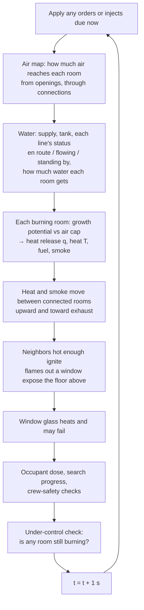

# How SizeUp's simulated fire works

*For fire officers. This describes the code in `src/model.js` exactly as it runs today (SizeUp v2, updated Oct 19, 2026: attic-origin fires (section 5i: ventilation-limited but sustained, eave fire spreading from the origin, roof burn-through and collapse warnings); Oct 14: basement window glass (5h); Oct 13: structural fuel and collapse (5g); Oct 11: basement smoke fix (one diluted plume per hidden side, below-grade gap leakage, basement-to-attic chase); optional Command fundamentals mode (section 5f); multi-side buildings and the 360 (Sides A to D, rear rooms, walk-out basement, follow-up report, side features); earlier: eave and gap smoke rework (localized, starved-fire fade, no lockstep), companies and dispatch, editable task times, per-engine water, time of day and weather, wind-driven fire; earlier the same day: knockdown, multiple lines, attic access, under-control state).*

> **Read this first.** SizeUp uses a **teaching model**, not fire physics. It is not CFAST, FDS or any validated zone/CFD model. Every number in it is a **dimensionless index** (0 = nothing, 1 = "flashover-level"), not °F, kW or ppm. The model's job is to put events in the **right order with roughly the right timing**, and to react to tactics the way the UL FSRI experiments describe. It cannot predict any real building. Training prototype, not for operational use.

Each rule below is labelled:
- **[FSRI: source]**: the behavior or timing is set to match a finding on the named UL FSRI page (quotes are in the app's *Behind the behavior* panel).
- **[Teaching value]**: a number chosen so the drill plays sensibly. It is not from research.

FSRI sources referred to:
- **VVR**: *Fire Service Summary Report: Vertical Ventilation and Suppression Tactics in Single Family Homes* (PDF)
- **VV**: *Effectiveness of Fire Service Vertical Ventilation and Suppression Tactics*
- **HV**: *Impact of Ventilation on Fire Behavior in Legacy and Contemporary Residential Construction*
- **CFA**: *Study of Coordinated Fire Attack Utilizing Acquired Structures*
- **FA**: *Impact of Fire Attack Utilizing Interior and Exterior Streams*
- **PPV**: *Effectiveness of Fire Service Positive Pressure Ventilation*
- **CBYD**: *Close Before You Doze: Before & After*
- **HV08**: *Impact of Ventilation on Fire Behavior in Legacy and Contemporary Residential Construction*, final report (DHS 2008 grant, PDF). Read: the full report.
- **ATTIC**: *Study of Residential Attic Fire Mitigation Tactics and Exterior Fire Spread Hazards on Fire Fighter Safety*, final report (PDF). Read: the full report.
- **NIOSH-BG**: NIOSH Workplace Solutions 2018-154, *Preventing Deaths and Injuries of Fire Fighters Working at Basement and Other Below-Grade Fires* (2018): https://www.cdc.gov/niosh/docs/2018-154/pdfs/2018-154.pdf. Read: the full 5-page PDF (indicators of a basement fire; tactics).
- **BSMT**: *Understanding and Fighting Basement Fires* (FSRI & ISFSI), project page and conclusions: https://fsri.org/research/understanding-and-fighting-basement-fires. Read: the project page (overview, context, conclusions).

Other research referred to:
- **NIST-ROOF**: NISTIR 7094, *Structural Collapse Fire Tests: Single Story, Wood Frame Structures* (Stroup et al., 2004): https://tsapps.nist.gov/publication/get_pdf.cfm?pub_id=861279. Read: the full report (truss roofs; collapse about 17 min after ignition).
- **NIOSH-TRUSS**: NIOSH Alert 2005-132, *Preventing Injuries and Deaths of Fire Fighters Due to Truss System Failures*: https://www.cdc.gov/niosh/docs/2005-132/default.html. Read: the alert summary.
- **NIST-WD**: NIST TN 1618, *Fire Fighting Tactics under Wind Driven Conditions: Laboratory Experiments* (Madrzykowski & Kerber, 2009), and NIST TN 1629, *… 7-Story Building Experiments* (2009). Read: the NIST publication pages and abstracts.

---

## 1. The building as the model sees it

- **Rooms ("zones")**: living room, kitchen, foyer, bedrooms, hall, attic/cockloft, and so on. Each has a size factor `vf` (1 = typical room; a big open room is 1.2–1.4). Bigger rooms heat and fill with smoke more slowly.
- **Openings to the outside**: windows, doors, the garage door, roof vents you cut. Each opening is *closed*, *open*, *failed* (broken glass) or *controlled* (door held to hose width).
- **Connections between rooms**, each with a "how freely do heat, smoke and air pass" number `k`:

| Connection | k | Label |
|---|---|---|
| Open archway / open plan | 1.0 | Teaching value |
| Interior door open | 0.9 | Teaching value |
| Open stair | 0.85 | Teaching value |
| Ceiling pushed (after roof/ceiling breach) | 0.6 | Teaching value |
| Interior door **closed** | 0.025 | Teaching value; the effect is FSRI: VVR/CBYD (closed door protects the room) |
| Intact ceiling to attic | 0.02 | Teaching value |
| Floor between the basement and floor 1 | 0.02 | Teaching value (same leak as a ceiling) |
| Wall | 0.004 | Teaching value |

### 1b. Four sides, rear rooms and the basement (multi-side buildings and the 360)

The building has four sides: **A** (front), **B** (left as you face A), **C** (rear) and **D** (right). Every opening belongs to a side and is backed by a room, so every window or door you can see on any side connects to the fire model.

- **Sample house.** Side A is the original picture. Sides B, C and D are **illustrated views** (drawn for this project to match the Side A mock; not photos). The house gained a rear bedroom on floor 2 (**Bedroom 4**, rear B/C corner) and a **basement** that is a **walk-out on Side C**: the yard falls away, so Side C shows **3 stories** (basement slider and window at grade, kitchen slider onto a deck, floor 2) while Side A shows 2. The basement connects to the kitchen through a closed **basement stair door** (`stair`), and to floor 1 through the floor (`floor`, k 0.02).
- **New openings use their own random stream.** Window-failure times for the original openings are drawn exactly as before, and the new side openings draw from a second seeded stream. That keeps old drills replaying identically. The extra air leakage from the new openings shifts the house's calibration timings slightly; the FSRI calibration tests (modern vs legacy) still pass.
- **Your own photos.** In the builder (step 2) pick a side and load its photo (Side A is required; B, C and D are optional). On each photo you mark the windows, doors and garage doors, the eave and grade lines, the stories visible on that side, and features. Each opening is mapped to a room automatically by side and level: Side B → the left rooms, Side D → the right rooms, Side C → a rear room per floor, and anything below the grade line, or in an extra lowest story on a side that shows more stories than the front, → the **basement**. You can change the room in the "Openings → rooms" list. A side with no photo can carry a **text description**, shown in the drill instead of a picture together with a live line from the model (for example: smoke from the Side C basement window).
- **Hidden truth.** The builder's marks are the scenario's truth. They are drawn only on the builder step. During the drill there are no outlines or labels on any side, and the board's "Showing" and "Smoke" lines only list sides you have seen. The flow-path arrows stay as an opt-in toggle.

**Rendering per side.** The picture shows the side you are looking at, on the same drill clock. Smoke and fire are drawn from that side's openings, with the eave rules of section 4h applied to that side's own eave or gable vents. Smoke from openings on the other sides is drawn as **one plume per hidden side**, placed toward that side: from the front, Side B shows at the left edge of the building at eave height, Side D at the right edge, and Side C behind the ridge over the room it comes from (as seen from the side you stand on). Openings that are only leaking around a closed frame count at 0.15× their rate; an opening at grade or basement level (rooms on floor 1 or B) only shows over the roof when its diluted rate is above 0.15, others above 0.05. The plume is one density step lighter than its source, 40% blended toward a grey sky, at 0.38 opacity and a capped rate. [Simplification; drawing only, not the model.] *Why (Oct 11, 2026 fix):* earlier builds drew one dense ridge plume per hidden opening, copying the basement's density, so a basement fire looked like heavy roof/attic smoke from the front within seconds of the basement filling.

**Hidden wings (Oct 13 garage fix) [Drawing simplification].** A low wing that is completely behind the building from a side (the house's 1-story garage, on the D end, seen from Side B) draws no plume of its own on that side; its smoke shows there only once the attic has smoke, from the gable vent and eaves. From a side where such a wing has its own roof (Side A), smoke from its far-side openings rises from the wing's roof, not the main ridge.

## 2. What each room tracks

| State | Meaning | Range |
|---|---|---|
| `q` heat release | How hard the fire in this room is burning | 0 → ~1.4 (a flashed room is driven toward 2) |
| `T` heat | Hot-gas temperature index; **1.0 = flashover level** | 0 → ~1.5 |
| `s` smoke | How full of smoke the room is | 0 → 1 |
| `R` oxygen reserve | Air still trapped in the room/building that the fire can use | 1 at ignition → 0 |
| `fuel` | Fuel remaining | 1 → 0 |
| `wet` | How much water has cooled the room and its fuel | 0 → 1 |
| `steam` | Steam from water application (whitens smoke) | 0 → 1 |
| `kd` knockdown hold | Seconds the room has stayed wet, low and cool (see 5) | 0 → 10 s |
| `smold` dry time | Seconds a knocked-down room has sat dry with no water and no line standing by | 0 → 600 s |
| flags | ignited, ventilation-limited, decaying, flashed over, **suppressed** (water has taken away the post-flashover boost), knocked out, burned out, rekindled once | yes/no |

The building also tracks **under control** (the time every room that ignited was knocked down or burned out) and each hoseline (id, target, ready time, status).

Each opening also tracks a **glass heat** counter, and the hidden occupant (if any) tracks an exposure **dose** (0 → 1).

## 3. The clock: one-second steps

- The model advances in **1-second steps**. Before arrival it runs silently for the "time since ignition" you chose (e.g. 210 s). At arrival the drill clock reads T+0:00.
- At 1× the app runs one step per real second; 2×, 4× and 10× run 2, 4 or 10 steps per second. Evolve and +1 min run many steps at once.
- Every order or inject is a timestamped action. The same scenario, seed and actions always replay to exactly the same result.

Each step runs in this order:



## 4. Step by step

### 4a. Air supply (the flow path's "in" side)

Each opening lets in air according to its state:

| Opening state | Air value | Label |
|---|---|---|
| Closed window (leakage) | 0.004 | Teaching value |
| Closed door (leakage) | 0.007 | Teaching value |
| Door **controlled** (to hose width) | 0.15 | Value is teaching; the effect is FSRI: VVR, CFA ("the door should be controlled until water is applied") |
| Open/failed window | 0.5 | Teaching value |
| Open door | 1.0 | Teaching value |
| Open garage door | 1.5 | Teaching value |
| Roof vent | 1.25 | Teaching value |

- **Wind** blowing into an opening multiplies its air by 1.4 / 1.9 / 2.6 for light / moderate / strong. [Simplification]
- A **PPV fan** adds +1.6 air to the room at the entry door. [Teaching value]

Air then spreads through the house in four passes:

```
air[room] = own openings + Σ over connections ( k × air[neighbor] × 0.6 )
```

Air reaching a room through an open stair or hall counts, but almost none passes a closed door (k = 0.025). That is how a **remote vent opening a flow path to the fire** shows up. [FSRI: HV, VVR, flow path]

If there is a **high exhaust** (a roof vent) in the room or a connected one, the room's air is boosted by up to 90% (`× (1 + min(0.9, 0.7 × exhaust))`), modeling low intake / high exhaust. [Behavior FSRI: VV; size teaching value]

### 4b. How a fire grows: the growth curve

A burning room has a **growth potential** that follows a "t-squared" curve, a standard fire-engineering shape:

```
potential = min(1.25, (time since ignition ÷ tg)²)
```

| Contents | tg (growth time) | Response time τ (heat release) | τT (heat) | Smoke factor | Fuel load |
|---|---|---|---|---|---|
| Modern synthetic | 250 s | 22 s | 50 s | 1.35 | 1000 |
| Legacy | 1400 s | 100 s | 190 s | 0.85 | 2600 |

These values were **tuned to FSRI: VVR timing**. FSRI found that a closed house went ventilation-limited in **about 5 minutes with modern fuel vs about 18 minutes with legacy**, and that ventilation-to-flashover took **about 2 minutes (modern) vs over 8 minutes (legacy)**. What SizeUp produces (living-room fire, closed house, glass held):

| | FSRI (VVR) | SizeUp today |
|---|---|---|
| Modern: ignition → ventilation-limited | ~5 min | 4.0 min (240 s) |
| Legacy: ignition → ventilation-limited | ~18 min | 16.7 min (1002 s) |
| Modern: door opened at 8 min → flashover | ~2 min | 1.8 min (107 s) |
| Legacy: door opened at 18 min → flashover | >8 min | ~16 min (982 s) |

The shape matches; the exact minutes are approximate.

Other rules:
- After flashover the potential is set to 2, meaning "burn as hard as the air allows." Once water has cooled a flashed room (water on it and wet > 0.5) it is marked **suppressed** and the boost is removed: the potential goes back to the normal curve. If it dries out (wet < 0.1) and regrows past q 0.6, the boost returns and the log says the fire regrew. [Simplification]
- An attic grows 1.6× slower.
- Below 25% fuel remaining, the potential falls with the fuel.
- Water multiplies the potential by (1 − 0.97 × wet).

### 4c. The air cap: ventilation-limited fire

The fire can only burn as hard as its air allows:

```
air limit      = 0.03 + 0.62 × air reaching the room
oxygen reserve R: refills slowly through openings, drains when the fire burns above the air limit
   R ← R + [ (own openings + 0.02) × 0.012 × (1 − R)  −  (q − air limit) × 0.0105 ÷ room size ] each second
cap            = air limit + 1.3 × R
target         = smaller of (potential, cap)
q              moves toward target:  q ← q + (target − q) ÷ τ   each second
```

- At ignition `R = 1`, so a closed room grows on its trapped air at first. As the fire uses that up, `R` falls and the cap drops toward the leakage-only air limit.
- **Ventilation-limited** is flagged when the potential exceeds the cap by more than 0.03 (and the room isn't wet).
- **Decay (starved for air)** is flagged when it is ventilation-limited, the reserve is below 0.15, and the air limit is below 0.35.

This reproduces the FSRI sequence: growth, then ventilation-limited, then decay while the house stays hot. **New air from any source (a failed window, an opened door, a vent) raises the cap and starts a second growth stage.** [FSRI: VVR, "Once an opening is made, a second growth stage begins"]

**Lag**: `q` rises with τ = 22 s (modern) or 100 s (legacy), halved after flashover. Heat `T` lags further behind (τT 50 / 190 s). That is why a vent can look good for a minute and then turn bad. [FSRI: VVR, "The fire does not react to additional oxygen instantaneously… 2 minutes later…"]. The values themselves are tuned teaching values.

### 4d. Heat, fuel and smoke inside the room

```
heat target  = min(q, 1.3) × 1.15 (attic 1.0) ÷ √(room size) × (1 − 0.6 × wet)
T            moves toward heat target with τT rising; falls with a 240 s lag (6 s while water is on it)
fuel         ← fuel − q ÷ fuel load   each second
smoke made   = q × 0.02 × smoke factor ÷ room size  (+ steam × 0.004)
smoke vented = smoke × own openings × (0.012 + 0.03 × min(1.5, T))   (× 1.8 with a fan running)
```

All of these constants are teaching values.

### 4e. Flashover

A room flashes over when **heat T reaches 1.0 and heat release q is at least 0.75** (attics don't "flash"; they ignite). After that the room burns at whatever the air allows, and flames show at its openings. The trigger level is a teaching threshold. The *timing* it produces is calibrated to FSRI: VVR (section 4b).

### 4f. Heat and smoke moving between rooms; spread

For each connection, every second:

```
smoke moved = (smoke difference) × k × 0.035   capped at 0.05
heat moved  = (heat difference)  × k × 0.018   capped at 0.03
```

- Movement **upward** is ×1.5 and **downward** ×0.45, because hot gas rises.
- Movement toward a room that has exhaust openings is multiplied by (1 + exhaust) for smoke and (1 + 1.6 × exhaust) for heat. Heat and smoke head for the vent, which is the flow-path effect. [FSRI: HV, VVR]
- A running fan multiplies heat movement ×1.6. [Teaching value; behavior FSRI: PPV]
- The receiving room gains 90% of the moved heat (÷ its size); the sending room loses 25%. The gap stands in for hot gas still flowing.

**Spread / extension**: an unburned room ignites when its heat passes **0.82** (the attic at **0.60**) and it isn't wet. It starts partway up its own growth curve (a head start of 0.55 × tg). [Teaching values]

**Exterior extension**: once a flashed room has had flames showing out an opening for **200 s**, the room above is exposed (its heat is set to at least 0.9), or the attic if it is the top floor. On non-wood construction the window above also fails. [Simplification]

**Roof vent / attic**: a vertical vent opens a 1.25 roof opening and **pushes the ceiling below it** (the connection goes from 0.02 to 0.6). This ties the attic into the fire. [FSRI: VVR / VV]

### 4g. Window glass failure

Each closed window keeps a heat counter:

```
glass heat += [ (T − 0.30 if positive) + 1.5 × (T − 0.60 if positive) ]  each second
fails when glass heat > threshold, threshold = 14 to 31.5 (set randomly per window by the scenario seed)
```

With modern contents and the default 3½-minute arrival, the living-room glass fails about **4:50–5:20 after ignition**, and flashover follows about **80–85 s** later. The choice **"Window glass: Holds"** only lets glass fail above heat 0.72. That keeps the closed-house decay FSRI describes.

**This whole rule is a simplification.** FSRI notes the fire *can* fail a window, but the timing here is a teaching value, not an FSRI measurement.

### 4h. What you see: smoke volume, velocity, density, color

These come from the room the smoke is leaving. **The cue mapping is the widely taught "Reading Smoke" approach, not an FSRI measurement. [Simplification]**

| Cue | Driven by | Steps |
|---|---|---|
| **Velocity** (pressure) | `P = T × (0.6 + 0.6 × smoke) × 1.25 if ventilation-limited` | <0.18 Lazy · <0.45 Moderate · <0.8 Pressurized · else Turbulent. A decaying fire is capped at Moderate and shown **pulsing** [FSRI: VVR] |
| **Volume** | `q × smoke factor + 0.6 × smoke` | <0.25 Light · <0.6 Moderate · <1.05 Heavy · else Very heavy |
| **Density** | room smoke `s` | <0.3 Thin · <0.55 Moderate · <0.8 Thick · else Very thick. Ventilation-limited with s > 0.6 → at least Thick; flashed and ventilation-limited → Very thick |
| **Color** | state | Steam > 0.25 → **white**. Cool early fire → white/gray. Attic, or wood structure burning 7+ min after flashover → **brown**. Ventilation-limited or hot (T > 0.7) → **black** (modern) / gray-black (legacy). Otherwise **gray** |

**How much smoke leaves each opening:**
- Open: `smoke × (0.4 + T)`, ×0.35 if the door is controlled, ×1.6 for a roof vent, and ×1.7 at the other openings when a fan is running.
- Closed (leaking around the frame): `(smoke − 0.3) × (0.3 × T + 0.25 × building pressure × starved factor)`. **Below-grade fire** [NIOSH-BG for the indicator; the numbers are teaching values]: while a basement room is burning, closed openings of the rooms above it leak at `max(that, (smoke − 0.15) × (0.08 + 0.3 × T + 0.25 × building pressure × starved factor))`, so smoky but still-cool floors show at their gaps. NIOSH: *"Internal indicators of a below-grade fire include the presence of modest heat and dense smoke at the ground or first floor level, and the absence of visible fire."* That the same smoke shows at the first-floor window and door gaps outside is SizeUp judgment. Fires that never reach the basement are unaffected. The volume and velocity you can see from a gap are capped (Moderate, or Heavy if it's pushing hard). In a closed-up house this is the **first** smoke you see, from the fire room's own windows and door.
- **Starved factor** [FSRI: HV08 for the behavior; thresholds are teaching values]: 1 while every burning room still has air (oxygen reservoir R ≥ 0.3), falling linearly to 0 at R = 0.05. FSRI: "once the fire became ventilation limited the smoke being forced out of the gaps of the houses greatly diminished or stopped all together." So a starved, closed-up fire shows little or no smoke, and the app does not read that as a small fire.
- **Building pressure** = `1.7 × q × T` of the hottest fire ÷ (1 + 2.5 × total open-opening area), capped at 1. A growing fire in a closed-up house pushes smoke around the windows and doors of its smoky rooms (and, once the top floor is smoke-charged, at the eaves above it); opening the house relieves it. [Simplification]

**Eave / soffit / cornice smoke** (reworked Oct 9, 2026):
- **Where it comes from.** There are only two sources:
  - *Attic smoke* leaks at the eaves once the attic's smoke is above 0.15: `(attic smoke − 0.15) × (0.6 + 1.5 × attic T)`.
  - *Pressure push from the top floor*: the rooms directly under the roof push smoke out at the eaves once that floor is charged with smoke (room smoke > 0.5): `building pressure × starved factor × (smoke − 0.5) × 0.45`.
  - Smoke on a lower floor never pushes at the eaves. **A first-floor room fire in a closed house therefore shows at its own window and door gaps first, not at the eaves.** (Earlier builds used the smokiest room anywhere, so a living-room fire drew a band of smoke along the second-floor eave about 17 s after arrival. That was wrong.) [Simplification; the cue follows FSRI: ATTIC]
- **Localized, not a band.** The eave is split into the stretches above each top-floor room. Each stretch gets the larger of:
  - its room's own push, or
  - a share of the attic smoke weighted by how much fire and heat that room is feeding up into the attic: `0.12 + 0.88 × (room feed ÷ highest feed)`, where feed is `0.7 × fire (if burning) + 0.3 × T`.
  - Eave stretches with no room below (for example over the garage end) get 0.12 of the attic smoke.
  - Gable or soffit vents marked on a building (`eaveVents`) concentrate the attic smoke: ×1.6 at a gable vent, ×1.2 at a soffit vent.
  - Example: a Bedroom 1 fire with its window failed puts about 3× more smoke at the eave above Bedroom 1 than over the other rooms. [Teaching values]
- **Pulsing only for a starved attic.** Eave smoke "breathes" only when the attic itself is burning, ventilation-limited, and has no roof opening. The pulse is irregular (two out-of-step cycles per emitter), not a fixed rhythm. While the attic is starved, no eave flames are drawn. FSRI: "Once the ridge vent seals, the eaves will act as both the source of air as well as the exhaust and you may notice a pulsing of smoke out of the eaves. This is a sign that you have a ventilation-limited fire in the attic." [FSRI: ATTIC for the behavior; the pulse shape is a teaching value]
- **No lockstep anywhere** (drawing only, not the model). Every smoke emitter (window and door gaps, open openings, roof vents, eaves) gets:
  - its own random starting counter and a ±25% rate offset;
  - slow out-of-step "gusts";
  - a random interval between puffs (0.35–1.65 of the mean).
  So neighbouring emitters never puff together. Previously all 15 eave emitters spawned on the same frame every ~1.5 s, which read as a pulsing line.

**Neutral plane**: an open window exhausts from its top ~65%, a door from its top ~50%. Below that, air flows in. This affects how it is drawn. [Behavior FSRI: VV/VVR; fractions are teaching values]

**Flow path shown on the board**:
- An open opening with smoke outflow above 0.05 is an **exhaust**. A door or garage is listed as exhaust at the top *and* intake at the bottom.
- Open openings with little outflow are **intakes**.
- A roof vent is always exhaust; a fan door is always intake.

**Fire showing**: flames show at an opening of a flashed room when `q > 0.7` (size `0.6 × q`), or at a window of an unflashed room when `q > 0.6`. Water cuts visible flame to 25%.

**Stage label** (fire room): Incipient (q < 0.12) → Growth → Growth (ventilation-limited) → Decay (starved for air) → Fully developed → Fully developed: burning the structure (contents spent) → Decay (water applied, or contents and structure consumed after about an hour or more) → Knocked down (or Burned out). A room that never flashed can still decay when its contents are used up ("Decay (fuel consumed)"); a fully involved room cannot (see 5g).
- A room that water has darkened (wet > 0.3, q < 0.25) but that is not yet knocked down reads **Decay (darkened by water, can regrow)**, not "Fully developed".
- A flashed room burning below q 0.5 reads **Decay (after flashover)**.

**After knockdown** (simplification): a knocked-down room makes no new smoke, and what is left clears about 3× faster (plus a small extra clearing term). Its smoke is drawn **white/light** like cooling smoke and steam, with velocity capped at Moderate. Once the fire is under control, rooms that only had smoke clear the same way. Flames and window glow stop at knockdown.

## 5. What your orders do to the numbers

### 5a. Companies, crews and who does what [Simplification]

Before the drill, the **Dispatch** tab builds the assignment. The default preset, **Generic first alarm (residential)**, is a set of generic, editable teaching defaults. It is **not any department's SOP**.

| Unit | Staff | Arrives after dispatch | Equipment (editable) |
|---|---|---|---|
| Engine 1 | 4 | 4:00 | 1000 gal tank, 1500 gpm pump, 1000 ft supply hose, ground ladder, hooks; preconnects 1¾ in. 200 ft 150 gpm ×2 and 2½ in. 200 ft 250 gpm |
| Medic 1 | 2 | 5:30 | rehab / EMS standby |
| Engine 2 | 3 | 6:00 | same as Engine 1 |
| Battalion 1 | 1 | 6:30 | command only |
| Ladder 1 | 4 | 7:00 | ground ladders, aerial, PPV fan, saws, hooks |
| Engine 3 | 3 | 8:00 | same as Engine 1 |
| Rescue 1 | 3 | 9:00 | ground ladders, PPV fan, saws, hooks |

- **T+0 on the drill clock is when the first company arrives.** Later companies arrive at their dispatch time minus the first company's, and are **staged** until assigned. The board shows each company as *en route* (with a countdown), *staged*, *working* (task and countdown) or *available*.
- **Crew rules.** Each task needs a minimum crew: hoseline 2 (a 2½ in. line 3), primary or secondary search 2, horizontal vent 1, vertical vent 2, PPV 1, door control 1, pull ceiling 2, ladder a side 2, RIT 2 or more, scene lighting 1, rehab 1. An **engine always keeps 1 member at the pump**. A company works one task at a time, and **splits** to take a second task only if it has enough unassigned members left over. (Example: Engine 1 with 4 has 1 at the pump and 2 on a line, so 1 member is left for door control.)
- **Equipment rules.** Vertical vent needs saws and a ladder or aerial. PPV needs a fan. Pull ceiling needs hooks. An upper-floor window can only be vented by a company with ground ladders (or an aerial), or after that side has been laddered. A medic only does rehab; the chief only commands.
- **Assigning.** You can assign a task to a specific company on the board, or use **quick orders**, which pick the company that can start soonest (ties go to the usual type for the task, e.g. a truck for ventilation). A task given to a company that is still en route starts when it arrives. A busy company is refused with the reason: what it is doing, how many members are free, and how many the task needs. **Reassign** releases the company's current tasks and starts the new one. **Release** and **Withdraw** free the crew at once.
- **Lines are limited by crews and preconnects**, not by a fixed cap. A line uses a specific preconnect on a specific engine (its own, or any engine on scene for a truck or rescue crew).

### 5b. Task times [Teaching values, editable per drill]

Every number below is on the **Task times** tab, saved and exported with the drill. Each time is then multiplied by the **company factor**:

```
company factor = (1 + 0.15 × members below 4)      short staffing
               × 1.2 if cold & icy
               × (1 + 0.10 per 10 min the company has been working, up to +0.30)   if hot; rehab halves the build-up
```

| Task | Time (before the company factor) | Effect |
|---|---|---|
| Interior line | crew **enters** at 35 s + 0.08 s × hose needed (ft); **ready** after another 30 s per floor above the 1st + 15 s | Entering **opens the entry door** (or *controls* it if door control is on). Water starts at the ready time if there is fire within reach |
| Line to the attic/cockloft (via a room) | interior line time to the room below + 30 s to pull the ceiling | The ceiling between that room and the attic is **breached** (k 0.6). Water: **0.8** into the attic, **0.6** into the room below [Simplification; the ceiling-opening behavior follows FSRI: VV] |
| Exterior line | 35 s + 0.08 s × hose needed + 15 s | Breaks/opens that opening; water only into that room. Openings on any side can be used |
| Exterior line through a roof vent | exterior line time + 30 s per story | Only after a vertical vent is open. Water goes into the attic/cockloft |
| Reassign a line | interior → interior: 30 s + 30 s per floor moved (+30 s if pulling a ceiling); exterior → exterior: 30 s; inside ↔ outside: a new stretch | The line must still be long enough for the new target |
| Withdraw a line / release a task | immediate | The crew is free again |
| Supply line (forward or reverse lay) | 45 s + 0.15 s × hydrant distance (ft) + 45 s hookup (+30 s for a reverse lay) | The receiving engine's lines stop drawing on its tank. Default hydrant 400 ft → 150 s, ×1.15 for a 3-member engine |
| Horizontal vent | 15 s | Opening becomes open/failed |
| Vertical vent | 300 s (×0.8 with an aerial) | Roof hole + ceiling pushed below it |
| PPV/PPA fan | entry door opens when the crew starts; fan on after 60 s | See below |
| Primary search | 60 s + 30 s per floor above the 1st + 120 s | Opens the entry door when the crew starts; secondary search ×1.3 |
| Pull ceiling (a room) | 30 s | Opens that room's ceiling to the attic, so a line in that room can reach it |
| Ladder a side | 45 s (×0.9 with an aerial) | Upper-floor windows on that side can then be vented by any company |
| Door control | immediate (1 member stays at the door) | Entry door held to hose width |
| RIT | 60 s to be in place | Logged; listed in the debrief |
| Scene lighting | 90 s | At dusk or night, smoke colour becomes readable (see 5d) |
| Rehab (medic) | 60 s | Heat fatigue builds at half rate while it is set up |

**Hose reach** [Teaching values]: a line must be at least as long as the hose needed:

```
interior:  setback (50 ft) + 25 ft to the room + 20 ft per floor above the 1st (+20 ft for a rear/hidden room, +10 ft for an attic line)
exterior:  setback + 15 ft (+40 ft to Side B or D, +80 ft to Side C) + 20 ft per floor above the 1st
```
If no free preconnect is long enough the order is refused: "Hose too short: … needs about N ft". A supply lay needs at least the hydrant distance of supply hose on the laying engine.

### 5c. Water: per-engine tanks, supply and gpm [Simplification]

- Each engine's **tank feeds only its own lines** until a supply line connects to that engine. A flowing line draws its own **gpm** (150 gpm = 2.5 gal per second). With the default 1000 gal tank, one 1¾ in. line runs about 6.7 min and a 2½ in. line about 4 min.
- **Low-tank warning** at 25% of that engine's tank; when it is empty, that engine's lines stop and restart once its supply is connected. Other engines are not affected.
- The **pump rating** caps an engine's total flow; above it, every line on that engine flows proportionally less (logged).
- **Water on the room scales with gpm**: a line's water = gpm ÷ 150 (limited to 0.4–1.7), so a 2½ in. line at 250 gpm wets a room about 1.7× faster than a 1¾ in. at 150 gpm. The knockdown thresholds are unchanged, so the FSRI-calibrated fire growth is untouched.

**Water** (rooms that receive it):
- An interior line gives its room **1.0**, and **0.45** to rooms joined by an open plan, open stair or open door.
- An exterior stream gives **0.85** to that room only.
- Each second under water:
  - wet rises by water ÷ 25
  - heat drops by 3.5% × water
  - heat release drops 6% × water and its target collapses with a 4 s lag
  - steam builds, so the smoke turns white
- **Knockdown** happens when the room has stayed **wet > 0.8, q < 0.12 and heat T < 0.3 for 10 s in a row** (the older rule, wet > 0.85 and q < 0.03, still counts too). Because water removes the post-flashover boost (4b), **flashed-over rooms can be knocked down**. Typical result: a flashed living room goes out about 35 s after the line starts flowing. [Simplification; the knockdown thresholds are teaching values]
- **Burned out**: a room with under 5% fuel left and q < 0.05 (and not air-starved) is marked burned out.
- **Lines stand by when there is no fire within reach.** Each line has a reach: its room plus the spill-over rooms above, or the attic and the room below for a pulled ceiling, or the one room for an exterior stream. If nothing in its reach is burning for 20 s, the line shuts down, but the crew stays in position. If fire comes back within its reach, the line starts flowing again. A line sent to a room with no fire stands by from the start, so it does not drain the tank.
- **Overhaul and rekindle** [Simplification]:
  - A knocked-down room with more than 30% fuel left can **rekindle once**. That needs it to sit **dry (wet < 0.05) for 600 s** with no water on it and **no interior line in position covering it**.
  - For an upper-floor room knocked down only from outside, the wait is 120 s (see the next point).
  - A rekindle restarts the growth curve from zero, so it is slow to build. It un-sets "under control" and is logged.
- Wet dries off slowly (over 900 s). For an **upper-floor room hit only from outside**, it dries in **70 s**, so the room can **regrow** unless an interior line follows. [FSRI: CFA]
- Water from any direction cools the fire room and the rooms around it. [FSRI: VVR, the 40% / 22% finding; this behavior is qualitative and the code is not tuned to those exact percentages]
- Water does not push fire; only flow paths move it. [FSRI: VVR]

**Ventilation**:
- Horizontal and vertical vents simply add openings, raising air (the cap) and exhaust. If water isn't yet winning, the fire grows. [FSRI: VVR, VV]
- **Door control** changes the entry door's air from 1.0 to 0.15 and its outflow ×0.35. [FSRI: VVR, CFA]
- **PPV**:
  - adds +1.6 air into the entry room
  - multiplies heat movement ×1.6 and smoke venting ×1.8
  - multiplies outflow ×1.7 at every other opening, so a fan helps only when there is an exhaust in the fire room [FSRI: PPV, "Positive Pressure Attack is exhaust dependent"]
- **Defensive strategy** withdraws interior lines (the log names them) and stops searches. In Defensive the line list defaults to exterior streams.

**Multiple lines** [Simplification]:
- Any number of hoselines can work at once, interior and exterior in any mix, **as long as there are crews and preconnects** (5a). Each is listed on the board with its company, target and status: en route (with countdown), flowing, standing by, or no water (that engine's tank is empty).
- A new order **adds** a line; it never silently replaces one. When no company can staff it, the order is refused with the reason.
- Where two lines reach the same room, it gets the larger of their two amounts of water (amounts are not added together).

**Under control**:
- When every room that ignited is knocked down or burned out, the model logs **"Fire under control"**.
- The app then pauses the clock, shows a banner with *Open debrief* / *Keep playing*, and clears the flashover chip.
- If a room rekindles later, the state is cleared and logged.

**Picking orders while the clock runs**: the order dropdowns keep your choice when the board refreshes. The line list puts **burning rooms first** (🔥) and preselects the first burning room that has no line yet. One-tap chips (＋ Line → room) appear for burning rooms. Pressing an order button with nothing picked shows a message.

### 5d. Time of day and weather [Simplification unless marked]

- **Time of day** (day / dusk / night) changes what you see, not the fire. At dusk and night the photo is darkened and tinted, **fire glow lights the windows, the smoke and the nearby facade**, and smoke is drawn with low contrast so its colour is **hard to read**; the board says so. A company assigned to **scene lighting** (90 s) brings the contrast back. The renderer values are look-tuned, not measured.
- **Occupancy likelihood** (occupant option "likely by time of day"): a home is occupied with probability 0.35 by day, 0.6 at dusk and 0.9 at night (at night, in a bedroom); a business is occupied with probability 0.7 by day, 0.35 at dusk and 0 at night (closed). Teaching values.
- **Rain, snow and fog** are drawn over the scene; fog adds a haze that hides smoke and scatters fire glow. Precipitation does not change the fire model.
- **Cold & icy** multiplies every task time by 1.2. **Hot** adds crew fatigue (5b).
- **Wind and wind-driven fire** [NIST-WD for the behavior; magnitudes are teaching values]: wind blowing into an open window or door on the windward side adds air to that room (×1.4 / 1.9 / 2.6 for light / moderate / strong). When that room is burning hard (q > 0.5), heat moving out of it along the flow path is multiplied by 1 + 0.45 × (wind strength 1–3), with a larger per-second limit, and a crew warning is logged: *"Wind-driven conditions: wind entering … is pushing heat and smoke through the flow path."* This follows the NIST finding that wind *"rapidly caused conditions in the structure to deteriorate by forcing fire gases through the apartment of origin and into the public corridor and stairwell"* (TN 1629 abstract). NIST also found that blocking the wind (wind control devices) and exterior water into the fire-room window from below reduced the hazard; in SizeUp you can close the flow path or put exterior water into the windward opening.
- A **scheduled wind shift** (Time & weather tab) changes the wind at a set drill time, logged on the timeline. It lives in the scenario, so a replay gets the same shift at the same second. The starting wind saved in the scenario is never overwritten by a shift or an instructor's wind inject.

### 5e. The 360, the follow-up report and side features [Simplification unless marked]

- **The walk.** The side tabs above the picture (or a swipe on a phone) change the view. The **first** look at each of Sides B, C and D costs drill time, default **30 s** (Task times → "360 & sides"); the clock runs on while you walk. After that, switching sides is free, as if crews there are reporting. Side A is free. Each view is logged with its time; "360 complete" is logged once all four sides have been seen.
- **Follow-up report.** The board's 360 card builds the report from a pick-list of findings (walk-out basement, basement, more stories than from the front, fire showing, smoke showing, victim seen, power lines, fence/access problem, exposure threatened, car blocking access, nothing new), each with a side. You also give the strategy (confirm or change; a change is applied), assignment changes, the accountability location, and optional free text. The report is checked against the scenario truth **at the moment you give it**: stories by side, a basement or walk-out, fire or smoke on Sides B, C and D, and marked hazards. *Key* findings are the ones that change the plan: extra stories, the basement or walk-out, fire on another side, and a threatened exposure. Free text counts: "walk-out basement in the rear" matches. The check is a teaching aid, not a grade against any SOP.
- **Debrief.** The debrief shows which sides you viewed and when, whether you gave a follow-up and how many key findings it had, and anything reported that the model did not find. For each missed key finding it shows **that side's picture with the missed item outlined**. It also checks whether tactics adapted: a basement fire attacked from its own level (walk-out door or basement window) versus only down the interior stair, lines sent to fire found on another side, an exposure protected, and tasks blocked by power lines.
- **Basement-to-attic chase** [NIOSH-BG for the behavior; the rate is a teaching value]. Once a basement room has caught fire, smoke moves from it to the attic at `(basement smoke − attic smoke) × 0.0025 per second` (÷ attic size; at most 0.01 per second), standing in for pipe chases and cable and vent holes. In the sample house with defaults the attic passes the eave threshold (smoke 0.15) about 5 to 6 minutes after ignition, so the eaves show light smoke a few minutes after arrival, never first. NIOSH: *"During recent basement fire experiments conducted by NIST and UL, smoke was observed coming out of the eaves in buildings that were not balloon-frame construction. Researchers suspect this was due to the presence of unprotected vertical penetrations, pipe chases, and holes for cable, phone, internet, and vent pipes."* Only basement fires use the chase.
- **What a basement fire shows outside** (stair door closed vs open). Closed: the smoke stays below; the basement windows and the Side C walk-out leak at grade (mostly visible on the 360); the front shows little until a basement window fails or the chase reaches the eaves. Open: the stairway carries smoke up, the first and second floors fill and leak at their window and door gaps (front, about a minute after arrival in the sample house), and the basement's own openings leak less. [Model behavior; the closed/open contrast follows FSRI: BSMT's stair-door flow path; the timings are teaching values.]
- **Basement fires** [FSRI: BSMT for the behavior; thresholds are teaching values]. A basement fire is ventilation-limited and feeds on the stair door and basement windows. An interior line to the basement from floor 1 goes down the interior stair: it **opens the basement stair door**, the stairway becomes the fire's exhaust, and a crew warning fires once the basement is hot (T > 0.5). Crews working on floor 1 over a burning basement get a **collapse-risk warning**; collapse itself is not modelled. A line through the walk-out door (pick "Basement @ Side C basement slider" in the line list) or exterior water through a basement window attacks the fire from its own level. FSRI: *"Each of these suppression methods provided a means of fighting the fire at its own level, without having to operate over the fire on an unrated wood floor assembly as well as remaining out of the exhaust portion of the basement fire flow in the basement stairway."*
- **Features** (teaching rules, not measured values):
  - **Fence** on a side: +30 s to stretch any line that goes to or through that side.
  - **Power lines** on a side: no ground ladders or aerial on that side, so no outside vent of upper-floor windows there.
  - **Car** on a side: blocks the aerial there; laddering that side uses ground ladders only and takes ×1.25.
  - **Exposure** building on a side: from arrival, while fire shows from openings on that side it builds radiant "heat". A flame-weighted counter warns at 20 and ignites the exposure at **240** (about 4 min of strong flame; editable) unless a company is assigned **Protect an exposure** (2 members, 60 s to set up).
  - **Porch/deck** and **utility meter**: notes only.
- **Hose reach around the building** (5c) already adds extra hose for Sides B/D and C.

### 5f. Command fundamentals mode (optional) [Public sources + teaching values]

An optional teaching layer, switched on in the Set up step (Command tab). **With it off, the model and the board run exactly as before** (a regression test compares 85 scenarios and a full UI flow against the previous build, event for event). It uses SizeUp's own wording and is **not affiliated with, endorsed by, or a substitute for any commercial incident-command certification program**. Concept sources: Alan V. Brunacini, *Fire Command* (NFPA, 1985), for the eight functions of command; Phoenix Regional SOP M.P. 201.01, *Command Procedures* (public PDF), for command positions, radio reports, benchmarks and transfer; FEMA NIMS for accountability terms. Every time, threshold and score below is an **editable SizeUp teaching value** (Command tab → Teaching values), saved in presets and exported with the drill. Terms and pick-list wording are editable per department too.

- **Command position.** Investigating / fast attack / command post. With Investigating or Fast attack, the IC is with the crew on a portable radio: assignments, quick orders, supply and search orders to **any other company are refused** with an explanation (setting *Orders to other companies allowed in fast attack*, default 0). The IC's own company can still be assigned. Choosing Command post from either of the others takes **60 s** to set up; from then on IC #1 is not counted as a crew member (one fewer free member on that company). A transfer to the chief also lifts the limits.
- **Initial radio report.** A pick-list builder replaces the free-text radio box: unit on scene; building (stories, construction, occupancy, size); conditions (nothing showing / smoke showing / working fire / defensive conditions, floor, side); actions (the IC's own task, location, objective; strategy); position; command name and location (plus a resource call); optional free text. Each part is checked live against the model at that second, **using only the sides seen** (Side A, plus B/C/D after their walk): *conditions* = working fire if flame shows from any seen opening, smoke showing if smoke does (or from the eaves), defensive if 3+ rooms have flashed over or the attic and 2+ floors burn; *stories* accept the count from any seen side (so 3 is right for the sample house once Side C is seen); *position* fits fast attack when fire is on one floor in up to two rooms, else command post (nothing showing → investigating). ✓ = 1, ! = ½; letter grade A ≥ 6, B ≥ 5, C ≥ 4, D ≥ 3. Checks are hidden while answers are hidden. If the report gives the IC's company a task with a location, it is placed as that company's first assignment.
- **Assignments (task, location, objective).** Each company assignment carries a location and an objective (defaulted from the task; the debrief counts the ones you chose).
- **Progress reports (CAN).** Generated from the model and company state: a *status* report when a company's line first flows, a task finishes, or a search ends (with its result); *priority* when a crew has been inside for **15 min** (low-air alarm, needs relief) or a crew warning or flashover hits near its work (conditions worsening, needs a backup line, at most once a minute per company); and *on request*. Conditions are read from the model at the company's location; needs come from its state (backup line, water supply to this engine, relief, EMS, ready for an assignment). You acknowledge, and an assignment that fits a stated need marks it answered.
- **Benchmarks.** You declare all clear per floor (primary, secondary), under control and loss stopped. Each is checked at that second: all clear = that floor's search finished without being driven out; under control = no room still burning (the model's own detection, now internal); loss stopped = **2 min** after under control with every room's smoke < 0.35 and heat < 0.3. In this mode the drill no longer announces under control by itself: it pauses only when you declare it and the model agrees. With *Hints* on, the card says when the model already agrees.
- **PAR and strategy check.** A PAR comes due every **20 min**, after every benchmark and after a strategy change; taking it takes **30 s**. A strategy check comes due every **10 min** until under control is declared.
- **Transfer of command.** When the chief arrives, a guided transfer: arrive and look (30 s), contact face to face (45 s) or by radio (20 s), progress report (30 s, also logged as a CAN from IC #1), confirm assignments (30 s), announce (15 s). Each step advances the drill clock.
- **Command debrief.** Ten points for each of the eight functions of command (Brunacini), total out of 100. What counts: (1) report within 60 s, a position that fits, command named, transfer when the chief arrives; (2) building and conditions parts of the report, sides seen, follow-up given; (3) report score, priority reports acknowledged within 60 s, stated needs answered; (4) objectives chosen, average wait for a first task, first water within 3 min; (5) strategy fits, actions part, strategy checks answered within 2 min; (6) stationary command once 4+ companies are on scene, RIT assigned, assignments with a location; (7) follow-up, strategy checks, PARs taken within 60 s of coming due; (8) benchmarks true when declared (under control within 5 min of the fire going out), all clears matching finished searches. **The weights are SizeUp teaching values, not a certification standard.** The debrief also shows the radio report grade and a benchmark timeline.

### 5g. Structural fuel, ceiling burn-through and floor collapse [Published tests + teaching values] (Oct 13, 2026)
Contents burnout does not end a fire. Once a room flashes over, every exposed combustible is burning, including the interior finish; when the finish fails the wood framing (wall studs, floor and ceiling joists) is exposed and burns too. The model therefore keeps a second fuel per space, **structural fuel**, used once the contents are spent. A fully involved space ends only by suppression or by decay after a long burn (about an hour or more).

| Value | Model | Source / basis |
|---|---|---|
| Structure counted as involved | **60 s after flashover** (attic: 60 s after it ignites, since an attic is mostly framing and sheathing) | Teaching value. Flashover means all exposed fuel in the room is burning; the 1 min is a simplification so the event reads after the flashover event. |
| Burning rate on the structure once contents are spent | 70% of a fully developed fire | Teaching value (no single published figure for a whole room). |
| Structural fuel duration | load 4500 (the room keeps burning roughly an hour or more after the contents are spent, then decays) | Teaching value; set to match AJ's direction that an uncontrolled fire ends only through total involvement and decay "over a long time (an hour or more)". |
| Gypsum ceiling burn-through into the attic | **10:00 after the room flashes** (the ceiling connection opens, and a ceiling collapse hazard is logged) | Teaching value, set below the measured range: type X gypsum ceilings fell **13-26 min after flashover** [AWC/RISE](https://awc.org/wp-content/uploads/2022/02/TMT-PerformanceDesign-1811.pdf). Ordinary 1/2 in. gypsum is assumed to fail sooner. NIST notes that gypsum fall-off times in natural fires are uncertain [NIST GCR 15-985](https://nvlpubs.nist.gov/nistpubs/gcr/2015/NIST.GCR.15-985.pdf). For the attic hazard from below, see [FSRI attic study](https://fsri.org/research-update/fire-service-summary-report-released-study-residential-attic-fire-mitigation). |
| Floor clock over a basement fire (Oct 13 fix; Oct 14: counts from basement flashover) | warning when the basement hot layer is **severe**; the clock runs only after the basement has flashed and while it stays severe (T >= 0.82, the model's own threshold for igniting exposed fuel such as joists); pauses while the fire is knocked down | UL/NIST ARRA tests timed collapse from ignition, but in fires that became severe quickly; collapse followed once the floor system was involved and, with openings, the basement reached post-flashover conditions (>600 C at 280 s) [UL/NIST ARRA](https://technicalpanels.fsri.org/docs/2009_NIST_ARRA_Appendix_C.pdf). The earlier model timed from ignition and opened the floor before the basement had even flashed. |
| Collapse warning (both floor types) | as soon as the floor clock starts | FSRI: no reliable warning signs before collapse. |
| I-joist floor burn-through and "collapse likely" | **3:19 of severe exposure** | Same report, earlier unsprinklered tests: flashover 7:09 -> collapse 11:30 (4:21 later) and 5:15 -> 8:34 (3:19 later); Dutchess County I-joist test flashover ~2 min -> collapse ~4 min (2:00 later). 3:19 is the middle value. E119 flame passage and collapse were 3 s apart (6:00 / 6:03) [UL engineered lumber report](https://fsri.org/sites/default/files/2021-07/NC9140-20090512-Report-Independent.pdf), so burn-through and collapse are logged together. |
| Dimensional lumber floor burn-through and "collapse likely" | **8:16 of severe exposure** | Teaching value: 3:19 plus the 4:57 gap between the UL full-scale dimensional (11:57) and engineered (7:00) averages. |
| Floor system by building | house: engineered I-joist (**assumption**); 3-story mixed-use: dimensional lumber (**assumption**) | Assumption. The basement ceiling is treated as unprotected (an unfinished basement). With 1/2 in. gypsum the E119 times were I-joist 26:45 and 2x10 44:45; the model does not model protected floors yet. |

Limits: real collapse times depend on load, span, ventilation and protection. More ventilation made collapse faster in the UL tests (limiting air delayed dimensional collapse by 1:36 and I-joist by 0:49), and the tests found no reliable warning signs before collapse [FSRI engineered floors](https://fsri.org/research/improving-fire-safety-understanding-fire-performance-engineered-floor-systems). The floor timer pauses while the basement fire is knocked down or below the severity threshold. Limit: a ventilation-limited basement fire that never gets severe (for example with the stair door open in the sample house) does not run the floor clock, although UL Experiment 4 (openings closed) still collapsed at 6:49 once the floor itself was burning. Exterior fire into an attic (about 2-25 min by siding and sheathing type in the UL/IAFF tests, [interim report](https://www.iaff.org/wp-content/uploads/2024/08/UL-IAFF-DOE-Grant-DE-EE0009454-Interim-Report-V6-Final.pdf)) is not modeled separately. A closed-up room that never flashes stays ventilation-limited and keeps smoldering; the model does not force it to spread.

### 5h. Basement window glass [Published tests + teaching values] (Oct 14, 2026)
Basement window glass now fails only on the **basement's own hot layer**, at a near-flashover level, instead of the general glass rule (which started heating glass at a modest hot layer and failed basement windows about 4:50 after ignition, before the basement flashed).

| Value | Model | Source / basis |
|---|---|---|
| What the tests show | In the FSRI/ISFSI basement experiments, **every basement fire was ventilation-limited**. Basement windows were set open or closed before ignition, or broken by the researchers on a schedule (Experiment 6: two windows broken at 180 s and 213 s); the report does not describe basement windows failing on their own. With everything closed (Experiment 2) the basement peaked near 630 C at the ceiling by the fire and then decayed. | [Understanding and Fighting Basement Fires (FSRI/ISFSI)](https://technicalpanels.fsri.org/docs/Understanding_and_Fighting_Basement_Fires.pdf) |
| Glass cracking vs. fall-out | Cracking does not open a vent. Single panes crack at a **60-90 C** centre-to-edge pane temperature difference; the inner pane of a double-pane unit cracks under similar conditions, and the outer pane needs more than **13 kW/m2**. A vent forms only when the glass falls out: no fall-out below about **20 kW/m2** (4 mm glass) or **28 kW/m2** (6 mm); Shields et al. give more than **35 kW/m2** for major fall-out of 6 mm glass. | [Skelly, Roby & Beyler 1990 (VT thesis)](https://vtechworks.lib.vt.edu/bitstream/10919/42192/1/LD5655.V855_1990.S583.pdf); [Pagni, Thermal Glass Breakage (IAFSS)](https://publications.iafss.org/publications/fss/7/3/view/fss_7-3.pdf); [probabilistic fall-out model (IAFSS)](https://publications.iafss.org/publications/fss/11/444/view/fss_11-444.pdf) |
| Fall-out threshold for basement glass | basement hot layer **T >= 0.9** (flashover is about 1.0) | Teaching mapping. 20 kW/m2 is the usual flashover floor-flux criterion, so fall-out is set just below flashover. |
| Time to fail once above the threshold | about 15-30 s for a flashover-level layer (k = 10) | Teaching value. |
| Small window-well window (Side B) | heats at 0.6 times the rate | Teaching value (small pane, set in a well). |
| Double vs. single pane | not distinguished | Simplification. The sample house's glazing type is unknown. |

Result: with the stair door closed or open and nothing vented, the basement fire stays ventilation-limited with its windows intact (smoke only, no flashover, no floor events in 15 min), as in the FSRI tests. With a basement window open before ignition (like the UL/NIST openings-open experiments), the fire can flash, the remaining glass fails on that heat, and the floor events follow (section 5g). Above-grade windows keep the general rule.

### 5i. Attic fires [Published tests + teaching values] (Oct 19, 2026)
Applies to fires that **start in the attic** (an attic reached by extension from a room below still uses the earlier rules, so room-fire drills are unchanged). Before this fix an attic-origin fire grew on the room curve with no air supply of its own: at a 5-min arrival it showed fire at **every** eave stretch at once (about 5:15-6:00), then starved for air and decayed to a smoulder by about 9-10 min, so it looked like it went out.

| Value | Model | Source / basis |
|---|---|---|
| How fast an attic fire grows | growth potential peaks about **5:00** after ignition (tg 300 s), whatever the room contents (the fuel is the roof framing and sheathing). Ventilation-limited at about **5:20** in the sample house | FSRI attic study: Table 7.1 "Attic fire growth to ventilation limited in 5 minutes"; Exps 3A and 4A became ventilation-limited at about **7:45** and **8:00** [FSRI attic final report](https://fsri.org/sites/default/files/2021-07/Attic-Final-Report-Online.pdf), [fire service summary](https://technicalpanels.fsri.org/docs/Attic-Fire-FD-Summary-Report-4_2_15-OC-Corrections.pdf) |
| Ventilation-limited, but keeps burning | the attic has its own air supply from the soffit, ridge and gable vents (vent air 0.35 while the ridge vent is open, **0.25** once it melts shut), so it settles at a steady ventilation-limited burn instead of starving out | FSRI: "The openings provided for natural ventilation are not sufficient to maintain steady state burning and fuel limited fire behavior ... will nearly always become ventilation limited." Exp 2A was still uniformly above 600 F (1200 F at the centre) at 16 min; in 2B the fire was still burning in one quadrant at 22 min. The two vent-air numbers are **teaching values**. |
| Ridge vent seals; eaves pulse | ridge-vent smoke early, then the plastic ridge vent melts shut when the attic hot layer reaches **T 0.3** (about 4:10); after that smoke pushes from the eaves and soffits and pulses while the attic is ventilation-limited | FSRI 7.6: "Continuous ridge vents ... melt and collapse on the opening ... Once the ridge vent seals, the eaves will act as both the source of air as well as the exhaust and you may notice a pulsing of smoke out of the eaves." Seal threshold is a **teaching value**. |
| Where the eave smoke and fire are | the attic fire has a location along the roof (where you tapped it, or the centre if picked from the room list) and an **involved stretch** that grows from there. Eave smoke is heaviest over that stretch and lighter elsewhere; **fire shows at the eaves and gable vents only inside the involved stretch, and only once the attic is venting** (roof burned through or opened, or fully involved) | FSRI 7.5: after a roof opening "most of the burning was taking place at the vent locations in the roof, the gable ends, the eaves ...". In Table 7.1 the exterior shows smoke, not fire, from the vents through 5 min. The spread rates are **teaching values**: 0.04% of the attic length per second each way while ventilation-limited (FSRI 2B: still one quadrant), 0.2% once venting (the rest of the attic in about 2-4 min; NISTIR 7094: attic flashover about 5.5 min after the fire got into the attic). |
| Roof collapse warning | when the attic fire is burning the roof framing (about 3:00 after ignition in the sample house) | NIOSH 2005-132: unprotected truss systems can fail after 5 to 10 minutes of fire exposure, without warning; employ a defensive strategy once burning of truss members is identified [NIOSH Alert 2005-132](https://www.cdc.gov/niosh/docs/2005-132/default.html) |
| Roof deck burn-through | after **6:00** on the attic involvement clock (about 9:40 in the sample house): a roof opening appears over the origin and the attic starts venting (fast growth, fire at the hole) | NISTIR 7094 Test 2 (truss roof): fire into the attic about 8:00, flames lapping the roof 13:00, portions of the roof burning 14:00 [NISTIR 7094](https://tsapps.nist.gov/publication/get_pdf.cfm?pub_id=861279) |
| Roof collapse likely (lightweight truss) | after **9:00** on the involvement clock (about 12:40 in the sample house, about 3 min after burn-through) | NISTIR 7094: roofs collapsed 16:45-17:30 after ignition; Test 2 attic 8:00 -> collapse 17:00, Test 3 attic 8:00 -> collapse 16:00 (8-9 min after the fire got into the attic). NIOSH: 5-10 min. |
| Roof collapse likely (rafter / dimensional) | after 15:20 on the involvement clock | **Teaching value**: 9:00 x 1.7, the UL ratio of dimensional to engineered floor collapse (11:57 / 7:00). No attic rafter test was found. |
| Involvement clock | runs while the attic is burning on its structure and is not being wetted, at a rate set by the fire size: 0 for a smoulder (q 0.25), full speed at q 0.6 and above | **Teaching value** (so a starved attic ages more slowly than a free-burning one). |
| Roof system by building | house: lightweight truss (**assumption**, as in the FSRI and NIST test structures); 3-story mixed-use cockloft: no roof system set, so it uses the truss timings | Assumption. |

Result for AJ's case (attic origin, 5:00 arrival, unattended): heavy smoke from the eaves and gable vents on arrival, heaviest over the origin, no fire showing; ventilation-limited with pulsing eaves from about 5:20; the roof burns through over the origin at about 9:40, fire shows there first and spreads along the eaves; fully involved about 12:30; collapse likely about 12:40; still burning on the structure at 30 and 60 min. A line through a pulled ceiling still knocks it down (on arrival or after burn-through).

Limits: the attic is still one zone with a single heat value; the "involved stretch" only places the visible smoke and fire. Exterior fire into the attic through the soffits is not modelled. Vertical ventilation of an attic fire uses the general roof-vent rules. Gable vents are not separate openings (they are drawn from the eave-smoke reading).

#### Attic smoke on the picture (Oct 19, 2026, later) [Drawing + teaching values]

AJ (iPhone, setup Step 3, attic origin, 5-min arrival): the smoke was a thick brown-gray cloud over the whole roof line, rising well above it and spilling into the black letterbox above the photo. The setup preview and the drill use the same model state (both at 5:00 after ignition, same smoke values); the problem was only in how the attic eave smoke was drawn.

Causes: (1) each top-floor room's whole width of eave got one wide emitter per ~60 px, the three rooms over and next to the centre origin all at the full eave rate (the room segments are wide, so the distance weighting could not make a gradient), about 18 emitters at ~8 puffs/s each; (2) those eave puffs grow to ~250 px across (the "very heavy" volume adds 135 px), so they merged into one bank; (3) the renderer drew smoke over the whole canvas, including the letterbox bars; (4) Side A had no ridge line passed to the eave rules, so the early ridge-vent smoke never showed there.

| What | Value | Basis |
|---|---|---|
| Where attic smoke leaves | discrete soffit-vent points every **60 px** of eave, plus ridge-vent points every **45 px** over the origin until the ridge vent melts shut | FSRI-ATTIC 7.5, 7.6: smoke from the soffit and ridge vents; pulsing at the eaves once the ridge seals. Spacing is a drawing value. |
| Heaviest near the origin | each vent point weighted by its distance from the attic fire: 1 inside the involved stretch, falling to **0.15** with length scale **0.15** of the attic length | **Teaching value** (FSRI: smoke heaviest over the fire, the attic fills toward the far end) |
| Look | narrow sources (14 px, ridge 10 px), small puffs that widen only a little as they rise (about 3x), opacity from the model's attic density, lower toward the far end; colour from the model's attic smoke | Drawing values; colour and density are the model's |
| Clipping | smoke and flames are clipped to the photo; nothing is drawn on the letterbox bars | |
| Written smoke reading (drill text, size-up calls, debrief) | uses the app's Volume / Velocity / Density words (Light-Very heavy, Lazy-Turbulent, Thin-Very thick) and colour, capped while the smoke only leaks through the vents: **Moderate / Moderate / Moderate** while the attic burns behind its vents; **Heavy / Moderate / Thick** once about half the attic is involved; **Heavy / Pressurized / Thick** after roof burn-through; the attic's own (uncapped) reading once fully involved. Location: "from soffit vents (eaves)" (plus "ridge vent" until it seals, "roof vent" after burn-through), "heaviest near" the origin end while the involved stretch is under about 90% of the attic | **Teaching values**, following the model's existing gap-leakage cap (smoke seen through gaps is limited by the gap, not the fire). Colour stays the model's (brown: the roof structure). |
| Pulsing | an attic-origin fire's eave smoke pulses once the ridge vent has melted shut (or once ventilation-limited), until the roof burns through or the attic is fully involved | FSRI-ATTIC: "Once the ridge vent seals ... you may notice a pulsing of smoke out of the eaves." |

Result (iPhone 390x844, Step 3, Side A, 5:00, centre origin): distinct brown columns from the soffits, darkest over the middle of the roof and lighter at the ends; the sky over the house is about 45-55% touched by smoke (was 84-90%), the roof face about 38% (was 77-81%), and no smoke pixels in the letterbox (was ~2,800). The written reading now matches: at 5:00 "Moderate brown, moderate, moderate · pulsing · from soffit vents (eaves), heaviest near the middle of the roof"; 10:00 "Heavy brown, pressurized, thick · from soffit vents (eaves), roof vent"; 13:00 (fully involved) "Very heavy brown, pressurized, moderate". The size-up calls and the debrief score against the same reading. Room fires that extend into the attic keep the earlier drawing.

Also fixed: the phone layout line that sets the stage height and the 1.6x render resolution had been swallowed by a code comment since the multi-side update, so phones rendered the picture at 1x.

## 6. Occupant and crew-safety calculations

**Occupant** (hidden; placed by you, at random in an upper-floor bedroom, or by time of day as in 5d):
```
dose += 0.012 × (T − 0.25 if positive) + 0.009 × (smoke − 0.40 if positive)   each second
untenable when dose ≥ 1
```
This is a simplified stand-in for heat and toxic-gas exposure (FED-style), not a real tenability calculation. A closed door keeps the room's heat and smoke low, which matches FSRI's finding. [FSRI: VVR, CBYD; constants are teaching values]

**Search**:
- When a floor search finishes, the occupant is found if they are on that floor. The outcome is *rescued* if their dose never reached 1, otherwise *found after conditions were untenable*.
- **The search is aborted with a crew warning** if any room on that floor reaches heat **> 0.75**. A room behind a closed door counts at only 20% of its heat.

**Attack crew warning**: once a line crew has entered, the warning fires if the heat at the entry (front-door room), or in the fire room before their water is flowing, exceeds **0.85**. The message is: "Attack crew is between the fire and the exhaust." [Behavior FSRI: VV/VVR flow-path hazard; threshold is a teaching value]

## 7. Honest limits

- **Basement chase is one fixed path.** The basement-to-attic leakage is a single teaching rate, not tied to how the house is built (balloon frame would be far faster; NIOSH notes eave smoke even without it). Smoke from other sides is a diluted stand-in plume, not a 3-D flow around the building.
- **Not physics.** There are no real temperatures, gas concentrations, pressures or mass flows. Indices stand in for them so the *sequence and timing* resemble FSRI results.
- **Few calibration points.** Only the modern/legacy timings in section 4b are set to FSRI numbers; most other constants are teaching values.
- **Coarse building.** One heat value and one smoke value per room: no hot layer vs cool floor inside a room, and no separate doorways. Rooms in an uploaded photo are a generic left room / right room / hall per floor.
- **Random within the seed.** Window failure timing, occupant placement and similar draws come from the scenario seed. The same seed gives the same drill; a different seed gives slightly different timing.
- **Generic tactics.** Task times, crew sizes, equipment and the default first-alarm preset are generic, editable teaching values. They are not your department's SOPs.
- **Simple crews.** A task needs a fixed minimum crew; extra members don't make it faster (staffing only enters through the short-staffing factor). Crews move instantly when released. Apparatus position is not modeled (every engine is at the setback; a reverse-laying engine still supplies the attack engine). There is no air-supply (SCBA) clock, no command-post or accountability model, and no Mayday.
- **Weather is mostly visual.** Rain, snow and fog change visibility and task times only; they do not cool the fire. The wind-driven push is a qualitative stand-in for the NIST experiments, not a fitted value.
- **Sides are simple.** Each side is one picture with openings mapped to rooms; there is no 3D geometry, and the rear rooms of an uploaded photo are one generic room per floor. The 360 walk is a fixed time per side, not a distance. Basement floor collapse is a warning only. Exposure heat is a simple flame-time counter, not a radiation calculation. The sample's Sides B, C and D are illustrations, not photos.
- **Command mode is a rubric, not an evaluation.** The radio report check, the CAN wording and the 8-function scorecard are SizeUp teaching rules: they check order and completeness against the model, not the quality of real radio traffic, and they are not any department's SOP or a certification standard. Divisions/groups and a tactical worksheet are not modelled; PAR always succeeds (no missing crews).
- **Night is visual plus occupancy.** Darkness changes what you can read, not how the fire behaves.
- Reassign and pull-ceiling times, knockdown hold and rekindle timing are teaching values. They are not FSRI findings and not SOPs.
